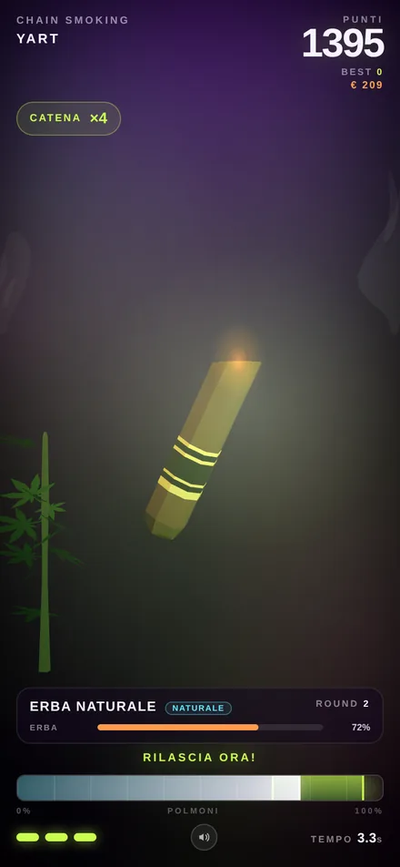

# Chain Smoking Yart — Canapuff Edition

Mini gioco browser **one-button**: tieni premuto, inala, rilascia nel punto giusto e fuma lo *Yart* il più a lungo possibile.

Mobile-first, nessun build step, ~800 KB totali (three.js vendorizzato + 3 modelli GLB da 93 KB).



## Come si gioca

- **Tieni premuto** in qualsiasi punto dello schermo per inalare: la barra dei polmoni si riempie e i punti salgono.
- **Rilascia quando la barra è nella zona verde**: fai un *PERFETTO*, la catena sale di 1 e prendi il bonus.
- La zona verde si sposta e si restringe man mano che la catena cresce.
- Se arrivi a **100%** tossisci: perdi la catena e un polmone. **3 colpi di tosse = run finita**.
- Rilasciare troppo presto (sotto il 30%) abbassa la catena.
- Se stai fermo troppo a lungo la catena scende da sola: meglio non smettere mai.

Punteggio = tempo fumato × catena + bonus perfetti. Il record resta in `localStorage`.

**Desktop:** barra spaziatrice al posto del dito. **Audio:** pulsante ♪ in basso (sintetizzato, zero file audio).

## Avvio in locale

Serve un server statico (i moduli ES non funzionano da `file://`):

```bash
cd chain-smoking-yart
python3 -m http.server 8000
# apri http://localhost:8000
```

## Deploy (GitHub Pages)

Il gioco è già statico nella root del repo: in *Settings → Pages* scegli **Deploy from a branch → main → / (root)**.
Nessuna action, nessuna build.

## Struttura

```
index.html          struttura + stile (HUD, menu, credits)
game.js             gioco, scena three.js, particelle, audio
vendor/             three.js r160 + GLTFLoader (MIT)
assets/models/      3 modelli Poly.Pizza + CREDITS.md
```

## Crediti

Modelli 3D da [Poly.Pizza](https://poly.pizza):

- **Vape** di [pgonarg](https://poly.pizza/m/kBOhB2eCji) — [CC BY 3.0](https://creativecommons.org/licenses/by/3.0)
- **Smoke** di [Quaternius](https://poly.pizza/m/RReLSfPo1Q) — [CC0 1.0](https://creativecommons.org/publicdomain/zero/1.0/)
- **Suspicious Plant** di [Rafael](https://poly.pizza/m/FJhXwFAoHw) — [CC0 1.0](https://creativecommons.org/publicdomain/zero/1.0/)

Renderer: [three.js](https://threejs.org) (MIT). Font: system stack, nessuna richiesta esterna.

Gioco parodia, nessuna sostanza reale è coinvolta. Fai finta di essere responsabile.
